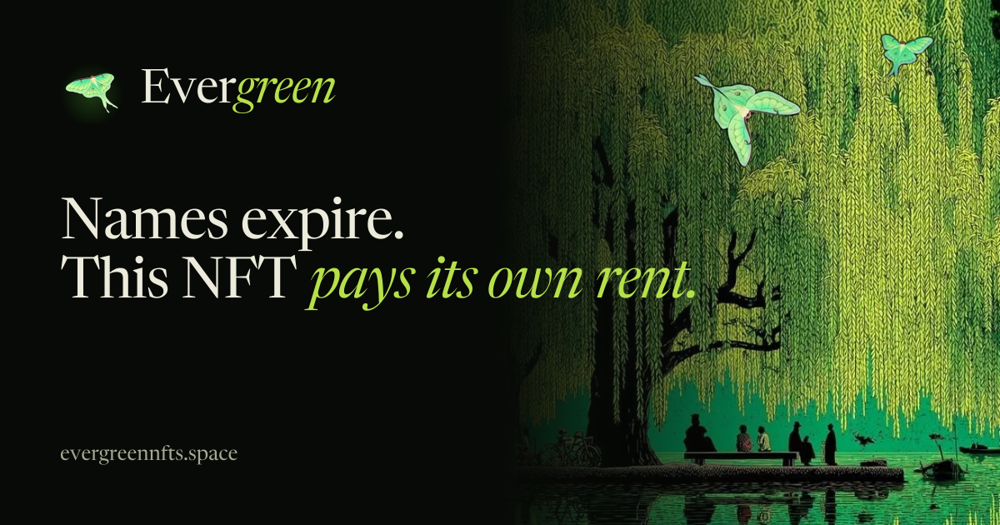
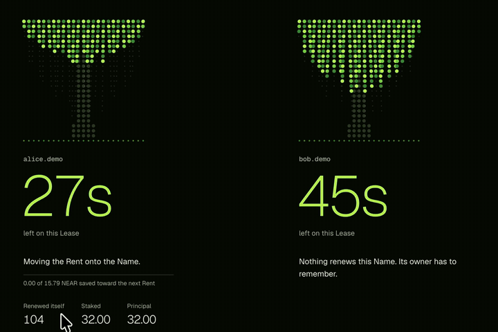
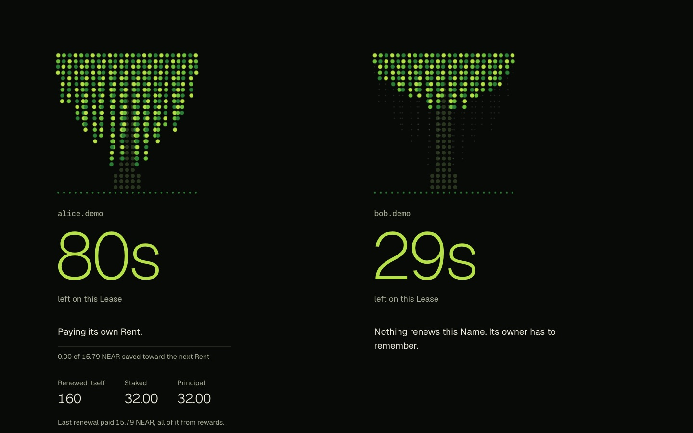
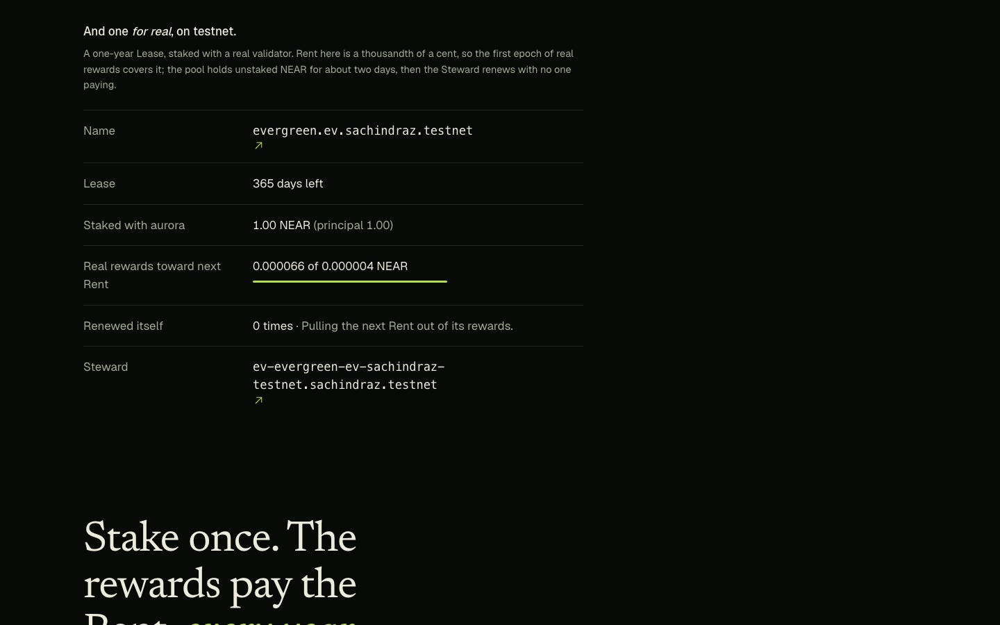
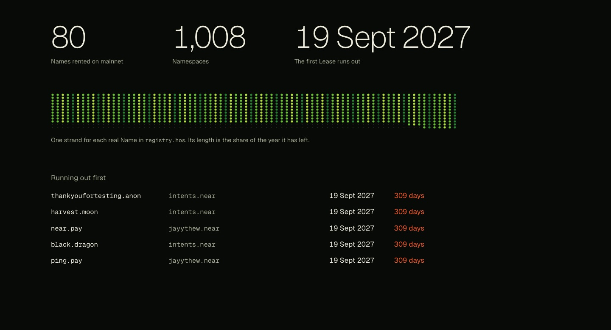
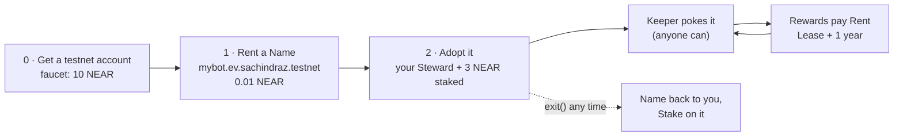
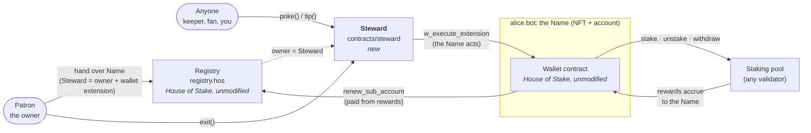
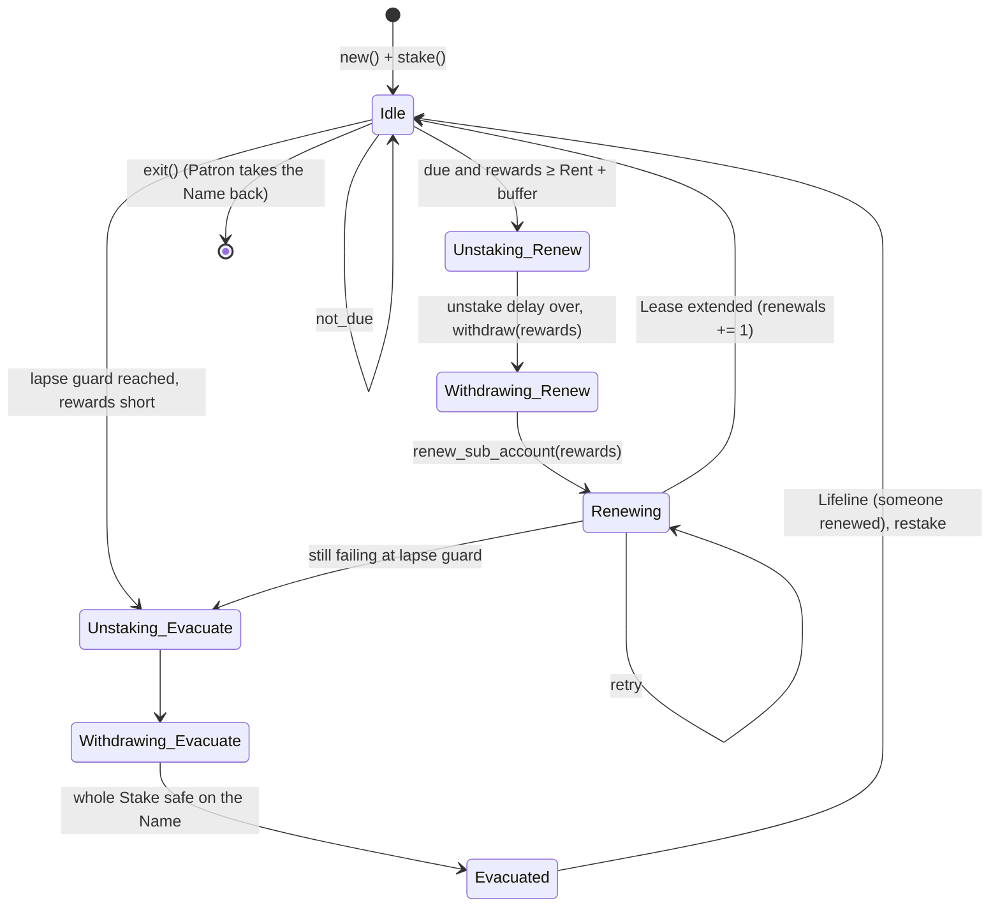
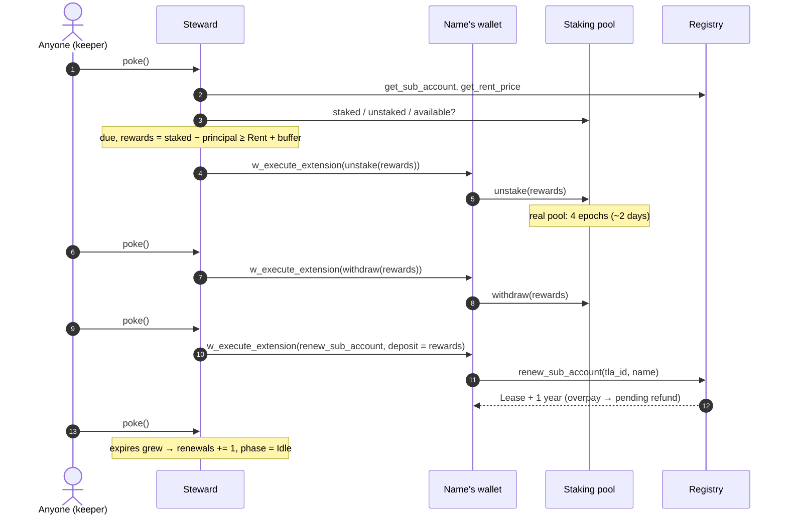
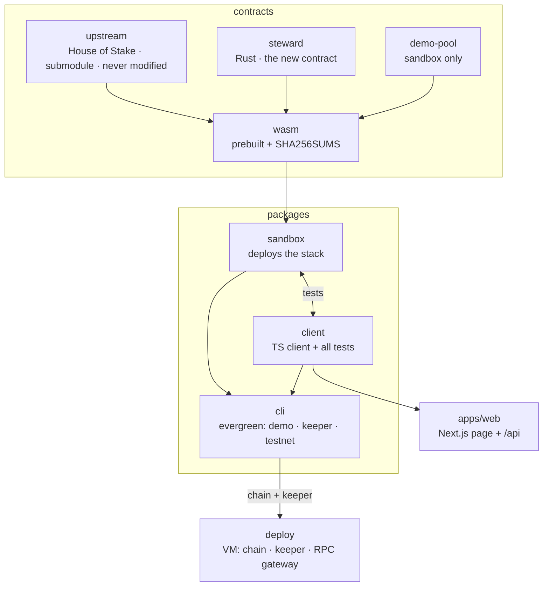

<p align="center">
  
</p>

<p align="center">
  <b>An NFT with its own bank account: it stakes, earns, and pays its own Rent, forever. Principal never spent.</b>
</p>

<p align="center">
  <a href="https://github.com/SachPlayZ/Evergreen/actions/workflows/ci.yml"></a>
  <a href="LICENSE"></a>
  <a href="https://evergreen-names.vercel.app"></a>
  
</p>

<p align="center">
  <a href="https://evergreen-names.vercel.app"><b>Live demo</b></a> ·
  <a href="#verify-it-in-3-commands"><b>Verify in 3 commands</b></a> ·
  <a href="#every-claim-and-where-it-is-proven"><b>Claims → proofs</b></a> ·
  <a href="#use-it-make-your-own-name-evergreen-near-testnet"><b>Use it on testnet</b></a> ·
  <a href="#architecture"><b>Architecture</b></a> ·
  <a href="#disclosures"><b>Disclosures</b></a>
</p>

A NEAR Top Level Account Name (`alice.bot`) is an NFT that is also a real account: it holds money and keys. Names are leased for a year. Miss one renewal and **anyone can take the Name, and every NEAR sent to it afterwards.**

Evergreen makes that NFT *do something*: it stakes its own NEAR, and a small contract (the **Steward**) uses only the rewards to renew the Lease every year. The principal is never spent. Nobody has to remember anything.

### Why this is an NFT that does something

Most NFTs are a pointer to a JPEG. This one is an economic agent. Every NEAR Name is a **NEP-171 token** in House of Stake's registry (`nft_token`, `nft_transfer`, `nft_transfer_call`) **and** a real NEAR account with its own wallet contract. Evergreen gives the token a job:

| The NFT… | How | Proof |
| --- | --- | --- |
| **is a wallet** | The token is an account: it holds NEAR and executes actions through its wallet contract | `w_execute_extension` in every `withdrawFromNameTx` / `stakeFromNameTx` ([txs.ts](packages/client/src/txs.ts)) |
| **earns** | The NFT's own account is the staker; stake and rewards sit with the validator in its name | `get_account_staked_balance(<the Name>)` on the pool; demo step 3 |
| **pays its own bills** | The Steward renews the Lease from rewards only | demo: *"renewed itself 2 times with no payment from ana"*, *"principal untouched"* |
| **can't die of neglect** | `poke` is permissionless; no server is trusted | demo step 5; the hosted keeper is just one poker among anyone |
| **can be kept alive by strangers** | Anyone can send a Lifeline (`tip`) that joins the stake | demo: *"fan's Tip joined the Stake"* |
| **is owned by code, and comes back** | `nft_token(...).owner_id` is the Steward contract; `exit` returns the NFT, its NEAR and its stake to the patron | test *"…taken back, Stake and all, into the Patron's hands"* |
| **is operable by AI agents** | Every action is a plain transaction; state is JSON | [`/agents.md`](https://evergreen-names.vercel.app/agents.md), [`/api/names`](https://evergreen-names.vercel.app/api/names?owner=evergreen-try-06844.testnet) |

Check it live: the NFT `evergreen.ev.sachindraz.testnet` is owned by a contract and is staking with a real validator.

```bash
near contract call-function as-read-only registry.sachindraz.testnet nft_token json-args '{"token_id":"evergreen.ev.sachindraz.testnet"}' network-config testnet now
# → "owner_id": "ev-evergreen-ev-sachindraz-testnet.sachindraz.testnet"   (the Steward contract)
```

<p align="center">
  <br>
  <sub>The live page, recorded. <code>alice.demo</code> falls to 24s, the Steward pays Rent from rewards, and the Lease jumps back. Principal stays at 32.00.</sub>
</p>

---

## TL;DR for AI reviewers

```yaml
project: Evergreen
track: NFTs That Do Something (also Open Innovation)
one_liner: An NFT with its own bank account. A NEAR Name (NEP-171 token + real account) stakes its own NEAR, earns, and pays its own yearly Rent from rewards; principal untouched; owned by a contract, returnable to the human at any time.
nft_angle: the token is the economic actor (holds funds, stakes in its own name, pays for its own existence, can be crowdfunded, agent-operable); not a cosmetic NFT
nft_proof: registry.sachindraz.testnet nft_token {"token_id":"evergreen.ev.sachindraz.testnet"} → owner_id is the Steward contract
verify:
  requires: [node>=22, pnpm]          # no Rust, no keys, no wallet, no network accounts
  commands: [pnpm install, pnpm test, pnpm demo]
  runtime: ~5 min total, local NEAR sandbox (real neard)
  pass_signal: "pnpm demo exits 0; every claim line starts with PASS"
  key_lines:
    - "alice.demo renewed itself 2 times with no payment from ana"
    - "principal untouched"
    - "bob.demo is Reclaimable: anyone can take it"
live:
  page: https://evergreen-names.vercel.app
  testnet_json: https://evergreen-names.vercel.app/api/testnet
  mainnet_json: https://evergreen-names.vercel.app/api/mainnet
new_code: [contracts/steward, packages/client, packages/sandbox, packages/cli, apps/web, deploy]
unmodified_third_party: contracts/upstream (House of Stake tla-contracts @ d85860a, checksummed in CI)
pre_hackathon_code: none (first commit 11 Nov 2026)
license: MIT
```

## Verify it in 3 commands

Needs **Node 22+** and **pnpm**. Everything runs on a local NEAR sandbox (a real `neard` node, downloaded by `near-sandbox`).

```bash
pnpm install
pnpm test    # ~3 min · 8 scenarios through the TypeScript client against a local NEAR chain
pnpm demo    # ~2.5 min · the whole story end to end · PASS/FAIL per claim · exits non-zero on any FAIL
```

**Expected `pnpm demo` output** (a real run; each `PASS` is an assertion):

```
== 3. Make alice.demo Evergreen
   PASS  the Steward contract ev-alice-demo.ana now owns alice.demo
   PASS  alice.demo staked 30.000 NEAR of its own NEAR
== 4. A stranger sends a Lifeline
   PASS  fan's Tip joined the Stake: principal is now 32.000 NEAR
== 6. The result
   PASS  alice.demo is still Active (54s left)
   PASS  alice.demo renewed itself 2 times with no payment from ana
   PASS  principal untouched: 35.158 NEAR staked, principal 32.000 NEAR
   PASS  bob.demo is Reclaimable: anyone can take it
== 7. ana takes her Name back
   PASS  alice.demo is back with ana; a Name is never locked in
```

Seconds left and the staked total vary slightly run to run. **Expected `pnpm test`:** `Test Files 3 passed (3)`, `Tests 8 passed (8)`.

CI runs the same commands on every push, plus `pnpm typecheck`, a SHA-256 check of every prebuilt contract, and a production build of the page: [ci.yml](.github/workflows/ci.yml).

### Every claim, and where it is proven

| # | Claim | Proof (run it or read it) |
| --- | --- | --- |
| 1 | An Evergreen Name renews itself from staking rewards, never from principal | `pnpm demo` steps 5–6 · test *"an Evergreen Name pays its own Rent from staking rewards, and never from principal"* in [steward.test.ts](packages/client/test/steward.test.ts) |
| 2 | Anyone can trigger a renewal (`poke`); no trusted keeper | [`contracts/steward/src/lib.rs`](contracts/steward/src/lib.rs) `poke()` has no caller check · the demo keeper is an unrelated account |
| 3 | If rewards can't cover Rent, the whole Stake leaves the pool *before* expiry; a Lifeline revives it | test *"if Rent cannot be covered, the Stake is pulled out of the pool before expiry; a Lifeline revives it"* |
| 4 | Without Evergreen, a lapsed Name goes to whoever reclaims it, **and so does any stake behind it** | test *"a staked Name that lapses hands its stake to the next renter"* in [lease.test.ts](packages/client/test/lease.test.ts) · `pnpm demo` step 6 (`bob.demo`) |
| 5 | The owner can take the Name back at any time, with its NEAR and its Stake | `pnpm demo` step 7 · test *"a Name made Evergreen from the published Steward code can be taken back, Stake and all, into the Patron's hands"* · `exit()` in [lib.rs](contracts/steward/src/lib.rs) |
| 6 | Registry, wallet, registrar, extension, recovery are House of Stake's contracts, **unmodified** | [`contracts/upstream`](contracts/upstream) submodule pinned at `d85860a` · wasm checked against [`SHA256SUMS`](contracts/wasm/SHA256SUMS) in CI · rebuild: `pnpm build:contracts` (Rust + cargo-near) |
| 7 | Works on House of Stake's *testnet* contract version, with a real one-year Lease | test *"on House of Stake's testnet contracts, an Evergreen Name renews its one-year Lease from …"* in [testnet-stack.test.ts](packages/client/test/testnet-stack.test.ts) · live on testnet (below) |
| 8 | 80 Names are rented on NEAR mainnet today, each one expiring | `curl -s https://evergreen-names.vercel.app/api/mainnet` (reads `registry.hos` live) |

## See it running (no install)

### 1. The live chain: 60-second Leases so you can watch

Open **https://evergreen-names.vercel.app** → scroll to **Live**.



- **Do:** watch `alice.demo`. **See:** its countdown falls to ~25s, then jumps back to ~83s. *Renewed itself* goes up by one, a moth flies off, **Principal stays at 32.00**.
- **Do:** watch `bob.demo`. **See:** no Steward, so it turns ember (Grace), then grey "Gone" (Reclaimable). The demo re-rents it so the cycle repeats.

A real NEAR node (sandbox) on a small VM, with a keeper that pokes alice. The page reads it through a read-only RPC gateway ([`deploy/`](deploy)). Up through judging.

### 2. A real one on NEAR testnet: one-year Lease, real validator



```bash
curl -s https://evergreen-names.vercel.app/api/testnet
```

- Name `evergreen.ev.sachindraz.testnet`, owned by Steward [`ev-evergreen-ev-sachindraz-testnet.sachindraz.testnet`](https://testnet.nearblocks.io/address/ev-evergreen-ev-sachindraz-testnet.sachindraz.testnet), staking 1 NEAR with `aurora.pool.f863973.m0`.
- On 14 Nov its first real rewards arrived (0.000066 NEAR, above the 0.0000049 NEAR Rent + buffer) and the Steward started its first self-renewal: `phase` is `Unstaking → Renew`. A real pool holds unstaked NEAR for 4 epochs (~2 days); then `phase` goes `Withdrawing → Renewing`, `renewals` becomes 1, and the Lease grows by a year. Every step is a transaction on nearblocks.

### 3. What's at stake on mainnet



Read live from `registry.hos`: 80 Names, 1,008 namespaces, the first Lease runs out 19 Sept 2027.

### 4. Your own chain, your own browser

```bash
pnpm evergreen sandbox --story   # terminal 1: local chain + the alice/bob story
pnpm evergreen keeper run        # terminal 2: pokes alice when Rent is due
pnpm dev:web                     # terminal 3: http://localhost:3000
```

## Use it: make your own Name Evergreen (NEAR testnet)

Anyone can do this today with free testnet NEAR. You get a real Name on a House of Stake registry (their contracts, unmodified, in the open namespace `ev.sachindraz.testnet`), and a Steward of your own that stakes it with a real validator. **Evergreen is not the rental service**: Names are leased from House of Stake's Top Level Accounts registry; Evergreen only adds the Steward.

### In your browser: [evergreen-names.vercel.app/app](https://evergreen-names.vercel.app/app)

Connect a testnet wallet (Meteor, Intear, Nightly, Ledger, or NEAR CLI via NEAR Connect), then:

1. **Rent a Name**: type a label, see if it's free and what it costs, approve one transaction.
2. **Make it Evergreen**: pick a stake, see the yearly rewards vs Rent estimate, approve four transactions in one go.
3. **Manage it**: add to the Stake, poke, take it back, pay Rent by hand, transfer the Name, withdraw NEAR from the Name, and after taking it back unstake and withdraw from the pool, or hand it back to its Steward.

Look at any account read-only, no wallet needed: [`/app?account=evergreen-try-06844.testnet`](https://evergreen-names.vercel.app/app?account=evergreen-try-06844.testnet). Agents: [`/agents.md`](https://evergreen-names.vercel.app/agents.md) (method reference + rules), [`/api/names?owner=you.testnet`](https://evergreen-names.vercel.app/api/names?owner=evergreen-try-06844.testnet) (state as JSON), and a copyable agent prompt on the app page.

### From the terminal



**0. Get a testnet account** (free, funded with 10 NEAR by NEAR's faucet; the key is saved where Evergreen looks for it):

```bash
npx near-cli-rs account create-account sponsor-by-faucet-service you.testnet \
  autogenerate-new-keypair save-to-legacy-keychain network-config testnet create
```

Already have one? Evergreen signs with `~/.near-credentials/testnet/you.testnet.json` (or set `EVERGREEN_KEY_FILE`).

**1. Get a Name.** It is an NFT and a real account, leased for one year:

```bash
git clone https://github.com/SachPlayZ/Evergreen && cd Evergreen && pnpm install
pnpm evergreen testnet rent mybot --account you.testnet
# mybot.ev.sachindraz.testnet is yours: an NFT and a real account, Lease ends in 365 days.
```

**2. Make it Evergreen.** Four transactions you sign: create your Steward, hand it the Name, fund the Name, stake. About 3.8 NEAR: 3 staked (your principal, never spent), 0.3 for the Steward account (its code is the published global contract `evergreen-steward.testnet`, so nothing big is deployed), 0.5 left liquid on the Name.

```bash
pnpm evergreen testnet adopt mybot --account you.testnet --stake 3
# mybot.ev.sachindraz.testnet is Evergreen. It now pays its own Rent from staking rewards.
#   Steward: https://testnet.nearblocks.io/address/ev-mybot-ev-sachindraz-testnet.you.testnet
```

**3. Leave it.** The hosted keeper finds every Evergreen Name in `ev.sachindraz.testnet` and pokes it when Rent is due (30 days before expiry). You never have to; anyone can.

| You want to | Run |
| --- | --- |
| See its Stake, rewards, phase, days left | `pnpm evergreen testnet status mybot` |
| Push it one step yourself | `pnpm evergreen testnet poke mybot --account you.testnet` |
| Add to its Stake (a Lifeline; anyone can) | `pnpm evergreen testnet tip mybot 1 --account you.testnet` |
| Take the Name back, Stake and all | `pnpm evergreen testnet exit mybot --account you.testnet` |

**Tested with a brand-new faucet account on 14 Nov 2026** (the full lifecycle, rent → adopt → take back → withdraw → hand back, also runs in the sandbox test above): [`hello.ev.sachindraz.testnet`](https://testnet.nearblocks.io/address/hello.ev.sachindraz.testnet), Steward [`ev-hello-ev-sachindraz-testnet.evergreen-try-06844.testnet`](https://testnet.nearblocks.io/address/ev-hello-ev-sachindraz-testnet.evergreen-try-06844.testnet), 3 NEAR staked with `aurora.pool.f863973.m0`.

<details>
<summary>From code instead of the CLI (TypeScript)</summary>

```ts
import { Evergreen, nearToYocto } from "@evergreen-names/client";
import { wasm } from "@evergreen-names/sandbox";

const client = new Evergreen({ rpcUrl: "https://test.rpc.fastnear.com", registryId: "registry.sachindraz.testnet" });
const me = client.account("you.testnet", "ed25519:...");          // your key
await client.rent(me, "mybot.ev.sachindraz.testnet");
const steward = await client.adopt(me, "mybot.ev.sachindraz.testnet", {
  pool: "aurora.pool.f863973.m0", stakeYocto: nearToYocto(3), stewardWasm: wasm("steward"), stewardBalanceYocto: nearToYocto(2),
  windowSecs: 30 * 86_400, lapseGuardSecs: 3 * 86_400,
});
await client.poke(me, steward);                                   // anyone, any time
```
</details>

**On mainnet?** Not yet, on purpose: the Steward is new and unaudited. Nothing in it is testnet-specific (the client takes any registry, and `registry.hos` runs the same contracts), so after an audit the same `adopt` works on a mainnet Name. House of Stake's own testnet registry works too (`--registry registry.hosdemo.testnet`, full name `x.hosdemo.testnet`) once its price oracle is updating again.

## The problem

House of Stake's [Top Level Accounts](https://github.com/houseofstake/tla-contracts) let anyone rent a short Name like `alice.bot` on NEAR mainnet. It is an NFT (NEP-171) **and** a live account with its own balance and keys. Leases last a year. Miss one renewal and, after a 14-day Grace, **anyone can reclaim the Name, and everything sent to it afterwards goes to them**. Our sandbox spike found the worse case: NEAR left staked behind a lapsed Name passes to the next renter too ([test](packages/client/test/lease.test.ts)).

A Name that holds money should not depend on its owner remembering a date.

## Architecture

### Who talks to whom



The Steward never holds the money. It **owns** the Name in the registry and is a registered **extension** of the Name's wallet, so it can make the Name itself stake, unstake, withdraw and renew. Why a contract and not a key: [ADR 0001](docs/adr/0001-steward-contract-owns-the-name.md).

### The Steward's state machine

Every `poke()` reads the Lease, Rent and pool position, then advances at most one step. Safe to call any number of times, by anyone.



`Unstaking`, `Withdrawing` carry a `purpose` (`Renew` or `Evacuate`) in the contract; the diagram spells them out.

### One renewal, end to end



### Safety rules, in one place

| Rule | Where |
| --- | --- |
| Only rewards (`staked − principal`) are ever unstaked for Rent | `on_poke`, `Phase::Idle` |
| Lapse guard: if Rent can't be paid before expiry, the **whole** Stake is pulled home first, so a lapse can't take it | `evacuate()` |
| Overpaid Rent is claimed back onto the Name | `claim_refund` in `on_poke` |
| Lifeline: anyone can `tip()` (joins the Stake) or renew directly; an `Evacuated` Steward restakes | `tip()`, `Phase::Evacuated` |
| Patron can always leave; the Stake stays on the Name and goes with it | `exit()` |

Rent is priced in dollars by the registry. At ~5% staking yield, **~$150 staked once covers $7.50 Rent a year** for a 12+ character Name.

## What is real and what is demo-only

| | |
| --- | --- |
| **Real, unmodified** | House of Stake registry, wallet, registrar, extension, recovery: built from [`contracts/upstream`](contracts/upstream) @ `d85860a` (mainnet version) and @ `d12a84b` (their testnet version, [`contracts/wasm/d12a84b`](contracts/wasm/d12a84b)). Checksums verified in CI. |
| **New (this hackathon), unaudited** | [`contracts/steward`](contracts/steward) (Rust, near-sdk), the TypeScript client, CLI, keeper and page. |
| **Demo-only** | On the hosted/local chain: 60-second Leases and Grace (real: 1 year / 14 days), and [`contracts/demo-pool`](contracts/demo-pool), which pays rewards on demand and releases unstaked NEAR at once (real pools: ~5%/yr, 4-epoch delay). The keeper also plays the price oracle there. On testnet: Rent is set to $0.00001/yr so one epoch of real rewards covers it. |
| **Why our own testnet registry** | House of Stake's testnet registries can't rent right now (their price oracle stopped updating on 7 Oct 2026, so every rent fails `rate_stale`). We deployed their exact testnet version, unmodified, and every Name's wallet runs their published wallet code (`impl.hosdemo.testnet`). Reproduce: `pnpm evergreen testnet deploy --account you.testnet` (~17 testnet NEAR). |

## Layout



| Path | What |
| --- | --- |
| [`contracts/steward`](contracts/steward) | The Steward contract (Rust, near-sdk) |
| [`contracts/demo-pool`](contracts/demo-pool) | Demo staking pool (sandbox only) |
| [`contracts/upstream`](contracts/upstream) | House of Stake Top Level Accounts contracts (submodule, never modified) |
| [`contracts/wasm`](contracts/wasm) | Prebuilt wasm + SHA256SUMS, so no Rust is needed to verify |
| [`packages/client`](packages/client) | TypeScript client; all tests live in `test/` |
| [`packages/sandbox`](packages/sandbox) | Deploys the whole stack to a local sandbox, or to testnet |
| [`packages/cli`](packages/cli) | `evergreen` CLI: the demo, the keeper, testnet deploy |
| [`apps/web`](apps/web) | The page (Next.js): live chain, testnet Name, mainnet census |
| [`deploy`](deploy) | systemd units + nginx for the hosted demo chain, keeper and gateway |

Terms: [GLOSSARY.md](GLOSSARY.md) · Decisions: [docs/adr](docs/adr) · Agent notes: [AGENTS.md](AGENTS.md)

### Commands

| Command | Does |
| --- | --- |
| `pnpm demo` | Whole story on a fresh sandbox, PASS/FAIL per claim |
| `pnpm test` | 8 scenarios (vitest) against a fresh sandbox |
| `pnpm typecheck` | TypeScript across the workspace |
| `pnpm evergreen sandbox --story` | Long-running local chain with alice/bob |
| `pnpm evergreen keeper run` | Pokes Stewards when Rent is due |
| `pnpm dev:web` | The page on http://localhost:3000 |
| `pnpm build:contracts` | Rebuild wasm from source (Rust + cargo-near), compare to SHA256SUMS |
| `bash contracts/build.sh --update` | After changing a contract, then `pnpm test` |

## Disclosures

- **All code was written during the hackathon** (first commit 11 Nov 2026, after the 19 Oct announcement). No pre-hackathon code, no existing product on another chain. This is our only submission.
- **Third-party code:** House of Stake [tla-contracts](https://github.com/houseofstake/tla-contracts) (unmodified, pinned). Libraries: near-sdk (Rust), near-api-js, near-sandbox, vitest, tsx, Next.js, React, motion, Lenis, Phosphor Icons.
- **AI:** built with Claude Code (Anthropic). Code, tests and the page were AI-generated and reviewed by the author.
- **Art** on the page is adapted from reference images (willow woodcut, luna moths, painted cat).

## License

[MIT](LICENSE), except `contracts/upstream` (its own licence).
